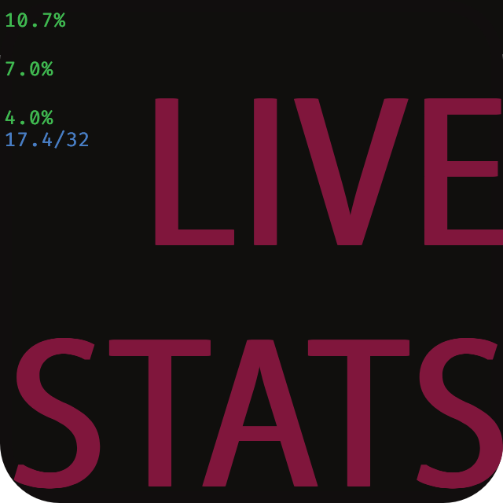

# Live Statistics
**V 0.1.0**

## Features
- *CPU Load precentage*
- *GPU Load precentage*
- *RAM <kbd>GBs in use</kbd>/<kbd>Avalible GBs</kbd> display*
- *RAM Load precentage*

## Source Code
⚠️ WARNING: Livestats-bloated.py may not work due to the icon.ico file being in the <kbd>/.ignore/</kbd> directory. If you want the version with icons, download the pre-compiled .exe file in <kbd>/.EXE/</kbd> directory. 
